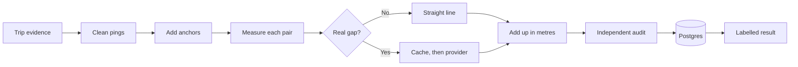

# GPS Distance Engine

**Every kilometre has a receipt.**

Cab vendors are paid per km, and that distance comes from GPS, which fails in tunnels and basements. This service rebuilds each trip's distance, calls a paid maps service only when it must, and labels every stretch of the trip with the rule that produced it, so a vendor dispute can be answered line by line.

MoveInSync SDE case study 1: GPS Gap Backfill & Billable Distance Reconstruction.

| | |
|---|---|
| **Stack** | Java 17, Spring Boot 4, PostgreSQL 16, Maven, Docker |
| **Tests** | 110 automated tests |
| **Result** | 10,000 trips and 15M pings in 8.3 seconds, 90% fewer provider calls, 1.26% average error on simulated trips |

**Contents:** [A disputed trip](#a-disputed-trip) · [Run it](#run-it) · [Try to break it](#try-to-break-it) · [How it works](#how-it-works) · [Results](#results) · [Requirement to proof](#every-requirement-and-its-proof) · [Tests](#tests) · [API](#api) · [Configuration](#configuration) · [Data model](#data-model) · [Failure handling](#failure-handling) · [Scaling](#cost-and-scaling) · [Caching](#caching) · [Monitoring](#monitoring) · [Security](#security-and-privacy) · [Code design](#code-design) · [Assumptions](#assumptions) · [Trade-offs](#trade-offs) · [Limitations](#limitations) · [Project map](#project-map)

---

## A disputed trip

A vendor says: "My driver did 31 km and your GPS says 18.4." The cab lost GPS for 22 minutes in an underpass and a basement. Two employees were dropped during that gap, and the system recorded where.

Adding up the GPS dots gives 18.4 km, because the missing stretch counts as one short straight line. This engine answers with a receipt:

| Stretch | Distance | Rule | Why |
|---|---:|---|---|
| GPS before the gap | 9.0 km | `SHORT_GAP_AERIAL` | Dots seconds apart, so a straight line is accurate |
| Last dot to drop 1 | 7.1 km | `ROUTED` | A real gap, so the road distance was bought from the provider |
| Drop 1 to drop 2 | 0.4 km | `SHORT_GAP_AERIAL` | The two drops were 60 seconds apart |
| Drop 2 to next dot | 7.1 km | `ROUTED` | A real gap |
| GPS after the gap | 7.0 km | `SHORT_GAP_AERIAL` | Dots seconds apart |
| **Total billed** | **30.6 km** | | Two provider gaps, one provider call |

These are the exact numbers from the case study's example, reproduced in `PdfExamplesTest`. The split between stretches is the test's own setup.

The same result, repeated with the same input and rule version, gives the same metres every time.

---

## Run it

You need Docker. Everything starts with one command:

```bash
docker compose up --build
```

The API is on port 8080. If that port is taken:

```bash
APP_PORT=8090 docker compose up --build
```

In a second terminal, watch the main flows. This needs `curl` and `jq`, and takes `APP_PORT` too if you changed it:

```bash
./scripts/demo.sh
```

The demo logs in, submits a trip, replays it, tries to read it as another client, closes the invoice, sends late pings, takes the provider down, watches the trip recover by itself, and prints the metrics.

Run the tests. These use an in-memory database and need no Docker, only Java 17:

```bash
./mvnw test
```

Run the full benchmark:

```bash
./mvnw -q -DskipTests compile
java -Xmx2g -cp target/classes com.moveinsync.distance.benchmark.BenchmarkRunner 10000 20
```

To start again with an empty database:

```bash
docker compose down -v
```

### How you see the results

There are no web pages or graphs. Results come back as:

- **JSON** from the API, showing the km, status and every labelled segment
- **Terminal output** from the demo, tests and benchmark
- **Metrics text** at `/actuator/prometheus`, ready for a tool like Grafana

---

## Try to break it

These checks were all run on the Docker stack. Start it, log in, and try them.

```bash
API=http://localhost:8080
TOKEN=$(curl -s -X POST $API/api/auth/login -H 'Content-Type: application/json' \
  -d '{"userId":"admin-a","password":"demo-password"}' | jq -r .token)
```

| Attack | How | What happens |
|---|---|---|
| Kill the maps service | `curl -X POST "$API/api/admin/provider?down=true" -H "Authorization: Bearer $TOKEN"` | Trips still return, marked `DEGRADED`, and cannot be billed |
| Bring it back | Same call with `down=false` | Degraded trips fix themselves within seconds |
| Crash the app | `docker compose kill -s SIGKILL app`, then `docker compose up -d app` | Degraded trips are picked up after restart |
| Stop the database | `docker compose stop db`, then `docker compose start db` | Callers get a 503 in about 3 seconds, and the same request works after restart |
| Read another client's trip | Log in as `admin-b` and fetch a `client-a` trip | 404, so you can't even learn that it exists |
| Replay a trip | Send the same trip twice | Same result, no new provider calls |
| Send garbage | Send a bad JSON body | A clear 400 that repeats none of your data |

---

## How it works



**1. Clean.** Remove duplicate pings, order by time, and drop fixes with accuracy worse than 50 m. Drop teleports faster than 120 km/h. Comparing each ping to the last good one fails if the first ping is bad, because every good ping then looks like a teleport. So pings are grouped into chains that make sense together, and the longest chain is kept.

**2. Anchor.** Add points we know the cab reached:

| Anchor | Rule |
|---|---|
| Employee | Actual pickup or drop if valid. Otherwise an ad-hoc rider's profile home and sign-in time, or a planned rider's planned location and time |
| No-show | Behind a flag. The no-show location if valid, otherwise the planned location |
| Office | The actual point if within 400 m of the office. Otherwise the planned office with the milestone's time |

**3. Measure.** Each pair of neighbouring points goes through fixed rules, in this order:

| Order | Condition | Distance | Label |
|---|---|---|---|
| 1 | Under 70 s at a plausible speed | Straight line | `SHORT_GAP_AERIAL` |
| 2 | 70 s or more, under 5 km/h | Straight line | `PARKED` |
| 3 | Otherwise, provider gave no answer | Straight line × 1.4 | `PROVIDER_DOWN_ESTIMATE` |
| 4 | Otherwise, route above 100 km | Straight line × 1.4 | `REJECTED_DISTANCE` |
| 5 | Otherwise, route and estimate both above 120 km/h | Straight line | `REJECTED_SPEED` |
| 6 | Otherwise | Road distance | `ROUTED` |

Full rules are in [docs/rules.md](docs/rules.md).

**4. Add up.** Straight-line distance uses the haversine formula with `StrictMath`, which gives the same result on every machine:

```text
a = sin²(Δlat/2) + cos(lat1) × cos(lat2) × sin²(Δlon/2)
distance = 2 × 6,371,000 m × asin(√a)
```

**Rounding:** each segment is rounded once to a whole metre and stored in a `long`. The total is their exact sum. The billable figure is rounded once, half up, to 0.1 km. So 30,550 m bills as 30.6 km and 30,549 m as 30.5 km.

**5. Audit.** `TripAuditor` shares no code with the engine and uses a different form of the formula. It rechecks every segment's rule, distance, order and total. A disagreement sends the trip to `NEEDS_REVIEW`.

**6. Store and bill.**

| Status | Meaning | Billable? |
|---|---|---|
| `OK` | All rules passed | Yes |
| `DEGRADED` | Contains an estimate because the provider failed | No, it is recomputed automatically |
| `NEEDS_REVIEW` | A route was rejected, the audit failed, or there were too few points | Only with `?reviewed=true` |

A closed invoice never changes. Late pings produce a signed correction such as `+1.8 km`.

---

## Results

Measured on an Apple M2 with 8 cores and 16 GB RAM, on Java 17, with other Docker workloads running. Full output is in [docs/benchmark-results.txt](docs/benchmark-results.txt).

### Speed and memory

| Measure | Result |
|---|---|
| Trips and pings | 10,000 trips, 15.05M pings, about 1,505 per trip |
| Run time | 8.3 s, including generating the fake trips |
| Throughput | 1,202 trips per second |
| Engine time per trip | p50 0.57 ms, p99 30.13 ms |
| Peak heap seen | 154 MB |
| Trips failing the audit | 0 |

The p99 is mostly the fake provider's 20 ms delay, which is an assumed value.

### Provider calls, the main cost

```text
One call per gap     ████████████████████  20,594
Batched per trip     ██████████            10,000   1.00 per trip
Batched and cached   ██                     2,104   0.21 per trip
```

Together, batching and caching cut calls by 90%. Each result also reports its own `providerCalls`. The cache figure depends on the simulator repeating 300 fixed corridors, as shift routes do, so a real hit rate must be measured on real traffic.

### Accuracy against the true distance

The simulator knows how far each trip really was, so accuracy can be measured.

| Method | Mean absolute error | Mean signed error | Worst trip |
|---|---:|---:|---:|
| Adding up the pings | 7.57% | +5.98% | |
| This engine | **1.26%** | -1.26% | 2.73% |

- The naive sum **over**-counts in this simulation, because false fixes add more distance than the tunnels lose. The case study describes under-payment, and the real direction depends on the data.
- The engine reads slightly low. The likely cause is straight lines cutting street corners, but that was not measured separately.

### Determinism and failure

| Check | Result |
|---|---|
| Two full 10,000-trip runs, with and without cache, disagreeing on the metres | 0 trips |
| Provider dies halfway through 10,000 trips | All finished, 1,266 marked `DEGRADED` |
| Degraded trips recomputed after recovery, differing from the healthy run | 0 trips |

### What this means

Vendors are paid close to the true distance, every km can be explained, and the maps bill is a fraction of the simple approach. A provider outage delays billing, but it can't change the final bill.

---

## Every requirement and its proof

### I. Ingest the trip evidence

| Requirement | Where | Proof |
|---|---|---|
| Inputs: pings, milestones, planned stops, office | `TripRequest`, `TripEvidence` | `scripts/sample-trip.json` |
| Remove duplicates, order by time | `PingCleaner` | `PingCleanerTest`, `DistanceCalculatorTest` |
| Drop low-accuracy fixes | `PingCleaner` | `PingCleanerTest` |
| Drop teleports over a configurable limit, default 120 km/h | `PingCleaner`, `app.rules` | `PingCleanerTest`, `RuleConfigurationTest` |

### II. Patch the gaps

| Requirement | Where | Proof |
|---|---|---|
| Employee anchor with defined fallback order | `AnchorBuilder` | `AnchorBuilderTest` |
| No-show anchor behind a flag, with planned fallback | `AnchorBuilder` | `AnchorBuilderTest`, `RuleConfigurationTest` |
| Office anchor with the 400 m rule | `AnchorBuilder` | `AnchorBuilderTest` |

### III. Distance for every segment

| Requirement | Where | Proof |
|---|---|---|
| Short gaps and parked gaps use straight line | `SegmentRuleEngine` | `SegmentRuleEngineTest` |
| Real gaps use the provider | `DistanceCalculator` | `DistanceCalculatorTest` |
| Reject over 100 km, or too fast | `SegmentRuleEngine` | `SegmentRuleEngineTest` |
| Every segment carries its rule | `Segment`, `SegmentRule` | `PdfExamplesTest` |

### IV. Cost, failure and recomputation

| Requirement | Where | Proof |
|---|---|---|
| Cache by snapped cells, batch, report calls per trip | `ResilientRouter`, `RouteCache` | `ResilientRouterTest`, `RouteCacheTest` |
| Provider failure: trip circuit, × 1.4, `DEGRADED` | `CircuitBreaker`, `SegmentRuleEngine` | `CircuitBreakerTest`, `ProviderFailureTest` |
| Recompute automatically on recovery | `RecomputeService` | `AutomaticRecoveryTest` |
| Same input and rule version, same km | `EvidenceHasher`, `DistanceCalculator` | `DistanceCalculatorTest`, `RecomputeServiceTest` |
| Late pings give a signed delta, invoice unchanged | `TripStore` | `RecomputeServiceTest` |

### Examples and key points

| Requirement | Proof |
|---|---|
| 31 km trip: naive 18.4, engine 30.6, two routed gaps | `PdfExamplesTest` |
| 9 km burst for 4 seconds is dropped, distance unchanged | `PdfExamplesTest` |
| Rule order deterministic and versioned | `SegmentRuleEngine`, `ruleVersion` on every result |
| Floating point and units, with rounding stated | [How it works](#how-it-works), `TripResultTest` |
| Provider calls before and after caching | [Results](#provider-calls-the-main-cost) |
| 10,000 trips of about 1,500 pings, time and memory | [Results](#speed-and-memory) |
| Provider fails halfway | `ProviderFailureTest`, [Results](#determinism-and-failure) |

### Plus points

| # | Point | Where it is covered |
|---|---|---|
| 1 | Authentication, roles, tenant isolation | [Security](#security-and-privacy), `TenantIsolationTest` |
| 2 | Time and space cost | [Cost and scaling](#cost-and-scaling), benchmark |
| 3 | Failure handling and injection | [Failure handling](#failure-handling), `ProviderFailureTest` |
| 4 | Object-oriented design and layers | [Code design](#code-design) |
| 5 | Trade-offs and what was left out | [Trade-offs](#trade-offs), [Limitations](#limitations) |
| 6 | Metrics and structured logs | [Monitoring](#monitoring) |
| 7 | Caching and staleness | [Caching](#caching) |
| 8 | Safe errors, no personal data | [Security](#security-and-privacy), `LogPrivacyTest` |

### Advanced Track

| Requirement | Where |
|---|---|
| Every hard rule tested, including concurrency and failure | [Tests](#tests) |
| Benchmark with throughput, p50 and p99, and the machine | [Results](#results) |
| Design note with architecture, sequence diagram and failure table | [docs/design-note.md](docs/design-note.md) |
| One-command run | `docker compose up --build` |

---

## Tests

There are 110 automated tests. They all run with `./mvnw test`.

| Area | Tests | Test class |
|---|---:|---|
| Case study examples, exact numbers | 2 | `PdfExamplesTest` |
| Billing rules and boundaries | 14 | `SegmentRuleEngineTest` |
| Anchors and fallback order | 15 | `AnchorBuilderTest` |
| Whole-trip calculation, determinism | 9 | `DistanceCalculatorTest` |
| Ping cleaning | 8 | `PingCleanerTest` |
| Haversine and speed | 3 | `GeoMathTest` |
| Rounding | 1 | `TripResultTest` |
| Provider timeouts, retries, batching, rate limit | 11 | `ResilientRouterTest` |
| Cache eviction and expiry | 3 | `RouteCacheTest` |
| Circuit breaker | 5 | `CircuitBreakerTest` |
| Concurrency on the cache and breaker | 2 | `ConcurrencyTest` |
| Failure: provider dies halfway | 1 | `ProviderFailureTest` |
| Failure: recovery with the real scheduler | 1 | `AutomaticRecoveryTest` |
| Failure: database down | 1 | `DatabaseDownTest` |
| Late pings, invoices, concurrent updates | 11 | `RecomputeServiceTest` |
| Auditor catches tampering | 5 | `TripAuditorTest` |
| Tenant isolation, roles, safe errors | 13 | `TenantIsolationTest` |
| No personal data in logs | 1 | `LogPrivacyTest` |
| Configuration | 2 | `RuleConfigurationTest` |
| Small benchmark on every build | 1 | `BenchmarkTest` |
| App starts | 1 | `GpsDistanceEngineApplicationTests` |

Bugs these tests found during the build:

- **Lost pings:** two late-ping updates could read the same trip, and the second save dropped the first one's pings. Fixed with a compare-and-set on the evidence hash.
- **Infinite speed:** a ping and an anchor with the same timestamp gave an infinite speed and a needless rejection.
- **Double close:** two closes at the same moment returned a 500. Fixed with a row lock.

---

## API

| Method and path | Roles | Purpose |
|---|---|---|
| `POST /api/auth/login` | Anyone | Get a token |
| `POST /api/trips` | Admin, operator | Submit a trip |
| `GET /api/trips/{id}` | All, employees for their own trips only | Result with every segment |
| `POST /api/trips/{id}/late-pings` | Admin, operator | Add late pings |
| `POST /api/trips/{id}/close` | Admin, operator | Close the invoice. Add `?reviewed=true` for a flagged trip |
| `GET /api/trips/{id}/invoice` | Admin, operator | Invoice and corrections |
| `POST /api/admin/provider?down=true` | Admin | Switch the fake provider off for demos |
| `GET /actuator/health` | Anyone | Health |
| `GET /actuator/prometheus` | Admin, operator | Metrics |

Demo users are `admin-a`, `operator-a` and `emp-1` for `client-a`, and `admin-b` for `client-b`. The password is `demo-password`.

Submit the sample trip:

```bash
curl -s -X POST $API/api/trips -H "Authorization: Bearer $TOKEN" \
  -H 'Content-Type: application/json' -d @scripts/sample-trip.json | jq 'del(.segments)'
```

A real response, with the long segment list removed:

```json
{
  "tripId": "demo-1793376577",
  "status": "OK",
  "ruleVersion": 1,
  "billableKm": 34.1,
  "providerCalls": 1,
  "metersByRule": { "SHORT_GAP_AERIAL": 22055, "ROUTED": 12020 }
}
```

An invoice with a correction:

```json
{
  "billedMeters": 34117,
  "corrections": [ { "deltaMeters": -58, "deltaKm": "-0.1 km" } ],
  "currentMeters": 34059
}
```

Errors are short and safe:

```json
{ "status": 400, "title": "Bad Request", "detail": "Invalid or missing fields: officeLatitude, tripId" }
```

---

## Configuration

Set under `app.rules` in `application.yml`. Any change to these limits must also raise `version`.

| Setting | Default | Meaning |
|---|---:|---|
| `version` | 1 | Rule version stored on every result |
| `max-speed-kmh` | 120 | Teleport and plausibility limit |
| `max-accuracy-meters` | 50 | Weakest GPS fix kept |
| `short-gap-seconds` | 70 | Upper limit of a short gap |
| `parked-speed-kmh` | 5 | Parked if slower than this |
| `max-route-meters` | 100000 | Longest route accepted |
| `road-factor` | 1.4 | Straight-line multiplier |
| `office-radius-meters` | 400 | Trust the actual office point within this |
| `include-no-shows` | false | Add no-show anchors |

Environment variables: `DB_URL`, `DB_USER`, `DB_PASSWORD`, `JWT_SECRET`, `DEMO_PASSWORD` and `APP_PORT`. The defaults in `docker-compose.yml` are for local use only.

---

## Data model

| Table | Holds | Key rule |
|---|---|---|
| `trip_record` | Latest result, status, evidence hash, stored evidence | Unique per tenant and trip |
| `invoice` | The billed metres | Never changes after it is written |
| `invoice_correction` | Signed metres | One correction per evidence hash |

The diagram is in the [design note](docs/design-note.md#data-model).

---

## Failure handling

| What fails | What the user sees | How it recovers | Tested by |
|---|---|---|---|
| Provider down | `DEGRADED` result, billing blocked with 409 | One retry, breaker opens, automatic recompute | `ProviderFailureTest`, `AutomaticRecoveryTest` |
| Provider hangs | Same, after the 2-second timeout | The timed-out call frees its slot | `ResilientRouterTest` |
| Provider rate limit | Same | Concurrent calls are capped, failures count toward the breaker | `ResilientRouterTest` |
| One batch fails | Real routes kept, failed gaps estimated, `DEGRADED` | Recomputed | `ResilientRouterTest`, `DistanceCalculatorTest` |
| Crash mid-work | Requests fail until restart | Degraded trips resume from Postgres | Manual `kill -9` |
| Crash during a save | Nothing partial | Result and correction share one transaction | By design, not fault-injected |
| Database down | 503, safe to retry | Works again when the database returns | `DatabaseDownTest`, manual stop |
| Duplicate or replayed input | Same result | Evidence hash match | `RecomputeServiceTest` |
| Out-of-order pings | Same km | Sorted first | `DistanceCalculatorTest` |
| Concurrent updates | All kept | Compare-and-set with retry | `RecomputeServiceTest` |
| Close during a late update | Correction kept | Trip row lock | `RecomputeServiceTest` |
| Auditor disagrees | `NEEDS_REVIEW` | Billing and corrections wait for review | `TripAuditorTest`, `RecomputeServiceTest` |

---

## Cost and scaling

Here n is pings per trip.

| Step | Time | Space |
|---|---|---|
| Sort and deduplicate | O(n log n) | O(n) |
| Teleport filter | O(n × c), where c is the number of chains. Usually small, O(n²) on pure noise | O(n) |
| Rules and totals | O(n) | O(n) |
| Route cache lookup | O(1) | Capped at 200,000 entries |

Trips are independent, so a thread pool spreads them across cores.

**Where it stops scaling, and why:**

1. **Provider limits come first.** Calls wait on the network, and a faster CPU doesn't help. Caching and batching are the levers.
2. **One JVM.** The cache and circuit breaker live in one process. Several instances would need shared state, such as Redis.
3. **Storage.** Evidence takes about 160 KB per trip, so 10,000 trips a day would add about 1.6 GB a day. This is an estimate from the sample trip.

---

## Caching

| Question | Answer |
|---|---|
| What is cached? | Road distance, keyed by snapped start and end cells of about 55 m |
| Eviction | Least recently used, capped at 200,000 entries |
| What can go stale? | A cached road distance, if the real road changes |
| For how long? | At most 24 hours |
| How is that bounded? | Each entry expires 24 hours after it was saved |
| What about a restart? | The cache is lost, which costs only extra provider calls |

The provider is always asked about cell centres, so a cached answer is identical to a fresh one. Finished results aren't cached in memory: replays are answered from Postgres by evidence hash.

---

## Monitoring

Metrics are at `/actuator/prometheus`.

| 3 AM question | Metric |
|---|---|
| Lag: how long has the oldest trip waited? | `trips_degraded_oldest_age_seconds` |
| Error rate | `http_server_requests_seconds_count`, `provider_failures`, `provider_timeouts` |
| Rejections | `segments_rejected_total`, `trips_failed_audit_total` |
| Retries | `provider_retries`, `trip_update_retries_total` |
| Queue depth | `trips_degraded_waiting` |
| Is the provider healthy? | `provider_breaker_open`, `route_cache_hits`, `route_cache_misses` |
| What is being billed? | `trips_processed_total`, `invoice_corrections_total` |

Logs are structured JSON and carry trip ids only.

---

## Security and privacy

- **Login:** signed JWT tokens lasting one hour, with bcrypt password hashes.
- **Roles:** employee, operator and admin, enforced per endpoint.
- **Tenant isolation:** the tenant comes from the signed token, never the request body, and every lookup includes it. Another client's trip is a plain 404, and two clients can use the same trip id safely.
- **Employees** see only their own trips, with no coordinates, because a segment's end point can be a home.
- **Errors** name a field but never repeat its value.
- **Logs** never contain locations, phone numbers, emails or rider ids. `LogPrivacyTest` plants a home location and rider id and confirms they don't appear.

---

## Code design

- **Layers:** `TripController`, then `TripService`, then `TripStore` and the repositories.
- **Plain core:** `core`, `model`, `routing`, `audit`, `simulation` and `benchmark` import no Spring or database code. They run in tests and in the benchmark with no server.
- **Encapsulation:** records are immutable, and classes such as `CircuitBreaker` keep their state private.
- **Inheritance:** `FakeRoutingProvider` extends `BaseRoutingProvider`, which holds what every provider shares. Errors extend `ApiException`.
- **Polymorphism:** the engine depends on the `Router` and `RoutingProvider` interfaces, so a real maps service plugs in without touching the rules. Each `ApiException` subclass supplies its own HTTP status.

---

## Assumptions

The first three are decisions the case study leaves open. The fourth resolves a contradiction in it.

1. **Low accuracy** means worse than 50 m. The case study gives no number, and it is configurable.
2. **Rejected routes:** the case study doesn't say what distance to use. Over 100 km uses straight line × 1.4, too fast uses plain straight line, and both flag the trip for review.
3. **Plausible speed:** a jump within 50 m counts as plausible, because a ping and an anchor at the same instant would otherwise give an infinite speed.
4. **Logout trips anchor the office at the start.** Read literally, the trip-end rule adds a return leg of about 30 km after the last drop, which contradicts the case study's own 30.6 km logout example. The rule is applied at the office end of the trip. This is a reading of the rule, not something the case study states.
5. **Valid point:** a milestone with coordinates but no time counts as invalid and uses its fallback. So does a location that is out of range or exactly 0,0.
6. **Long gap** means 70 seconds or more.

---

## Trade-offs

| Decision | Gain | Cost |
|---|---|---|
| Answer every trip, but block estimates from billing | Availability for reads, consistency for money | Billing waits during an outage |
| 2-second provider timeout, then an estimate | Bounded latency | Accuracy returns only after recompute |
| Compute outside the transaction | No database connection held during slow calls | Needs compare-and-set and a row lock |
| Snapped cells | Repeatable km and more cache hits | Each endpoint can move by up to about 40 m |
| Cache and breaker in one JVM | Simple and fast | One instance only |
| Evidence stored as JSON | Simple recompute | About 160 KB per trip |
| Separate auditor | Catches engine bugs | Extra code to keep in step with the rules |

More detail is in the [design note](docs/design-note.md).

---

## Limitations

**Data and accuracy**

- All accuracy and cost figures come from simulated trips. The city is a street grid where the road distance is known exactly, and real GPS may behave differently.
- The fake provider's 20 ms delay and the corridor pattern are assumptions.
- The engine reads about 1.26% low on simulated trips.
- Stationary GPS jitter under the short-gap rule adds small amounts of distance, because the rule order is fixed by the case study.

**Testing**

- Automated tests use an in-memory H2 database, not Postgres. Postgres was exercised through the Docker demo and manual checks.
- The `kill -9` and database-stop checks on Docker are manual.
- The benchmark measures the engine, not the HTTP API under load.
- The race between a close and a late-ping update never appeared in 40 test rounds before the fix. Its test guards the behaviour, and the row lock prevents it by design.
- A crash in the middle of a save is covered by the transaction, and was not separately fault-injected.

**Design**

- With a real provider, road answers can change over time, so a recompute after late pings could also shift by that drift. Storing each trip's route answers would fix this.
- Old rule versions aren't kept in code, so an old version can't be re-run after the rules change. Stored results keep their version.
- Changing a limit requires raising the rule version by hand.
- Two threads can miss the cache at once and both pay for the same route.
- A trip end with no time adds no office anchor.
- `reviewed=true` is accepted from any admin or operator, and who reviewed isn't recorded.

**Left out on purpose**

- A real routing provider, which costs money and makes failures harder to repeat
- Running several app instances
- A web interface and graphs
- Schema migrations: the app uses Hibernate's `ddl-auto: update`
- Login rate limiting and token revocation. Users are hard-coded demo accounts
- Encryption of stored evidence
- Road-accurate map matching

---

## Project map

```text
src/main/java/com/moveinsync/distance/
├── model/        Trip data: pings, milestones, segments, results, rule limits
├── core/         Cleaning, anchors, billing rules, trip calculator, evidence hash
├── routing/      Provider interface, fake provider, cache, circuit breaker, router
├── audit/        Independent recheck of every result
├── simulation/   Fake trips with a known true distance
├── benchmark/    The 10,000-trip run
├── controller/   HTTP endpoints
├── service/      Compute, save, recompute, wiring
├── repository/   Database access
├── entity/       Database tables
├── dto/          JSON requests and responses
├── security/     Login and roles
├── error/        Safe error handling
└── monitoring/   Metrics

docs/
├── design-note.md         Components, architecture, data model, APIs, sequence, failure table
├── rules.md               The billing rules and decisions, rule by rule
└── benchmark-results.txt  Full benchmark output

scripts/
├── demo.sh            Walks through the main flows
├── sample-trip.json   A trip to submit
└── late-pings.json    Late pings for that trip
```
