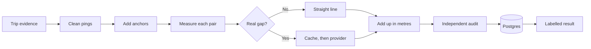

# GPS Distance Engine

**Every kilometre has a receipt.**

Cab vendors are paid per km, and that distance comes from GPS, which fails in tunnels and basements. This service rebuilds each trip's distance, calls a paid maps service only when it must, and labels every stretch of the trip with the rule that produced it, so a vendor dispute can be answered line by line.

MoveInSync SDE case study 1: GPS Gap Backfill & Billable Distance Reconstruction. Built with Java 17, Spring Boot 4, PostgreSQL 16, Maven and Docker.


## At a glance

| | |
|---|---|
| **Accuracy** | 1.26% average error, worst trip 2.73%, on simulated trips |
| **Cost** | 9.82 provider calls per trip down to 0.21 |
| **Speed** | 10,000 trips and 15M pings in about 8 s, 154 MB heap |
| **Determinism** | 0 of 10,000 trips differ between runs |
| **Failure** | Provider outage: every trip recovers to the exact metres |
| **API** | About 195 new trips per second on Postgres, p99 about 100 ms, 0 errors |
| **Tests** | 137 passing, 95.8% line coverage, 86.0% mutation score |

## Find what you need

| I want to... | Read | Written as |
|---|---|---|
| See the evidence | [RESULTS.md](docs/RESULTS.md) | A lab notebook of 13 experiments, with charts |
| Check the tests | [TESTS.md](docs/TESTS.md) | A catalogue of all 137 tests, plus coverage and mutation scores |
| Understand the design | [DESIGN.md](docs/DESIGN.md) | 30 decision records and every architecture diagram |
| Read the short version | [design-note.md](docs/design-note.md) | The one-to-two page note the case study asks for |
| Check a requirement | [REQUIREMENTS.md](docs/REQUIREMENTS.md) | Every line of the brief mapped to code and proof |
| Know what could go wrong | [LIMITATIONS.md](docs/LIMITATIONS.md) | A risk register, with severity and fixes |
| Use the API | [API.md](docs/API.md) | Copy-and-run recipes |
| Run it in production | [OPERATIONS.md](docs/OPERATIONS.md) | A 3 AM runbook, by symptom |
| Review security | [SECURITY.md](docs/SECURITY.md) | A list of attacks and answers |
| Learn the billing rules | [rules.md](docs/rules.md) | The rulebook |

## A disputed trip

A vendor says: "My driver did 31 km and your GPS says 18.4." The cab lost GPS for 22 minutes in an underpass and a basement. Two employees were dropped during that gap, and the system recorded where. This engine answers with a receipt:

| Stretch | Distance | Rule | Why |
|---|---:|---|---|
| GPS before the gap | 9.0 km | `SHORT_GAP_AERIAL` | Dots seconds apart, so a straight line is accurate |
| Last dot to drop 1 | 7.1 km | `ROUTED` | A real gap, so the road distance was bought |
| Drop 1 to drop 2 | 0.4 km | `SHORT_GAP_AERIAL` | The drops were 60 seconds apart |
| Drop 2 to next dot | 7.1 km | `ROUTED` | A real gap |
| GPS after the gap | 7.0 km | `SHORT_GAP_AERIAL` | Dots seconds apart |
| **Total billed** | **30.6 km** | | Two gaps, one provider call |

These are the exact numbers from the case study's example, reproduced in `PdfExamplesTest`. The split between stretches is the test's own setup.

## Run it

You need Docker. Everything starts with one command:

```bash
docker compose up --build
```

The API is on port 8080. If that port is taken, use `APP_PORT=8090 docker compose up --build`.

In a second terminal, watch the main flows. This needs `curl` and `jq`, and takes `APP_PORT` too if you changed it:

```bash
./scripts/demo.sh
```

Run the tests, which need only Java 17:

```bash
./mvnw test
```

Run the benchmark:

```bash
./mvnw -q -DskipTests compile
java -Xmx2g -cp target/classes com.moveinsync.distance.benchmark.BenchmarkRunner 10000 20
```

To start again with an empty database, run `docker compose down -v`.

### How you see the results

There are no web pages. Results come back as JSON from the API, terminal output from the demo, tests and benchmark, and metrics text at `/actuator/prometheus` for tools like Grafana. The charts in this repo were drawn from the measured data in [docs/results](docs/results).

## Try to break it

These all ran on the Docker stack. Log in first:

```bash
API=http://localhost:8080
TOKEN=$(curl -s -X POST $API/api/auth/login -H 'Content-Type: application/json' \
  -d '{"userId":"admin-a","password":"demo-password"}' | jq -r .token)
```

| Attack | How | What happens |
|---|---|---|
| Kill the maps service | `curl -X POST "$API/api/admin/provider?down=true" -H "Authorization: Bearer $TOKEN"` | Trips still return, marked `DEGRADED`, and cannot be billed |
| Bring it back | Same call with `down=false` | Degraded trips fix themselves within seconds |
| Crash the app | `docker compose kill -s SIGKILL app`, then `docker compose up -d app` | Degraded trips are picked up after restart |
| Stop the database | `docker compose stop db`, then `docker compose start db` | Callers get a 503 within about 3 seconds, and the same request works after restart |
| Read another client's trip | Log in as `admin-b` and fetch a `client-a` trip | 404, so you can't even learn that it exists |
| Replay a trip | Send the same trip twice | Same result, no new provider calls |
| Send garbage | Send a bad JSON body | A clear 400 that repeats none of your data |

## How it works



1. **Clean:** remove duplicates, sort, drop weak fixes and teleports.
2. **Anchor:** add pickup, drop, no-show and office points, with defined fallbacks.
3. **Measure:** apply six fixed rules to each pair of points.
4. **Add up:** whole metres in a `long`, rounded once to 0.1 km.
5. **Audit:** separate code rechecks every result before it can be billed.
6. **Store:** a closed invoice never changes, and late pings produce a signed correction such as `+1.8 km`.

The code is layered as controller, service and repository, and the engine is plain Java with no Spring, so it runs without a server or database.

## Benchmark results

Measured on an Apple M2 with 8 cores and 16 GB RAM, on Java 17. Full output is in [benchmark-results.txt](docs/benchmark-results.txt), and the deeper experiments are in [RESULTS.md](docs/RESULTS.md).

| Measure | Result |
|---|---|
| Trips and pings | 10,000 trips, 15.05M pings |
| Run time | 7.6 to 8.8 s across runs, including generating the trips |
| Throughput | 1,140 to 1,310 trips per second |
| Engine time per trip | p50 about 0.45 ms, p99 26 to 30 ms |
| Peak heap | 154 MB |
| Provider calls per trip | 1.00 before caching, 0.21 after |
| HTTP on Postgres, new trips | 194 to 196 per second, p50 about 35 ms, p99 94 to 107 ms |

These are simulated trips and a fake provider with an assumed 20 ms delay.

## Assumptions

1. **Low accuracy** means worse than 50 m. The case study gives no number, and it's configurable.
2. **Rejected routes:** over 100 km uses straight line × 1.4, too fast uses plain straight line, and both flag the trip for review.
3. **Plausible speed:** a jump within 50 m counts as plausible, because a ping and an anchor at the same instant would otherwise give an infinite speed.
4. **Logout trips anchor the office at the start.** Read literally, the trip-end rule adds a return leg of about 30 km, which contradicts the case study's own logout example. This is a reading of the rule, not something the case study states.
5. **Valid point:** a milestone with coordinates but no time is invalid and uses its fallback.
6. **Long gap** means 70 seconds or more.

More are in the [rulebook](docs/rules.md#decisions-where-the-spec-is-silent).

## Trade-offs

- **Availability for reads, consistency for money.** A trip is always answered, using an estimate if needed, but an estimate can never be billed.
- **Latency over accuracy, temporarily.** A 2-second provider timeout keeps requests bounded, and the accuracy returns through recompute.
- **Simplicity over scale.** The cache and circuit breaker live in one JVM, so running several instances would need Redis.
- **Repeatability over precision.** Snapping points to cells of about 55 m makes km repeatable, and can move an endpoint by up to about 40 m.

All 30 decisions are in [DESIGN.md](docs/DESIGN.md#7-decision-records), and every known gap is in [LIMITATIONS.md](docs/LIMITATIONS.md).

## Project map

```text
src/main/java/com/moveinsync/distance/
├── model/        Trip data: pings, milestones, segments, results, rule limits
├── core/         Cleaning, anchors, billing rules, trip calculator, evidence hash
├── routing/      Provider, cache, circuit breaker, router
├── audit/        Independent recheck of every result
├── simulation/   Fake trips with a known true distance
├── benchmark/    Benchmark, experiments and HTTP load test
├── controller/   HTTP endpoints
├── service/      Compute, save, recompute, wiring
├── repository/   Database access
├── entity/       Database tables
├── dto/          JSON requests and responses
├── security/     Login and roles
├── error/        Safe error handling
└── monitoring/   Metrics
docs/             All documents, charts and raw results
scripts/          Demo and sample trip
```
