# Design dossier

The full reasoning behind the GPS Distance Engine. Every major choice is recorded as a decision: what the problem was, what else was considered, what was picked, why, what it cost, and when it should change.

For the short version the case study asks for, see the [one-to-two page design note](design-note.md).

**Part 1:** [Goals](#1-goals-and-constraints) · [Architecture](#2-architecture) · [Flows](#3-how-the-main-flows-work) · [State](#4-state-machines) · [Data](#5-data-model) · [Concurrency](#6-concurrency-model)

**Part 2:** [Decisions](#7-decision-records) · [At 100 times the load](#8-what-changes-at-100-times-the-load)

---

## 1. Goals and constraints

### What the system must do

Rebuild a billable distance for each cab trip from unreliable GPS, so that both MoveInSync and the vendor can trust it, and explain every kilometre.

### Forces that shape the design

| Force | Consequence |
|---|---|
| The number is money | It must repeat exactly, so no drift, no hidden state and no silent changes |
| GPS is unreliable | Input must be cleaned and gaps rebuilt from other evidence |
| Routing is slow and paid per call | Most gaps must never reach the provider, and the provider can't be trusted to stay up |
| Vendors dispute bills | Every metre needs a stated reason |
| Billing closes | Late data can't rewrite history |
| Many clients share one system | One client must never see another's data |
| Home locations are personal data | They must stay out of logs, errors and employee views |

### Non-goals

- Real-time tracking. Distance is computed from a finished trip's evidence.
- Road-accurate map matching. The case study defines its own rules, and they are followed.
- Payment or vendor settlement. The system stops at the invoice and its corrections.

---

## 2. Architecture

### The system

Who uses it, what runs, and what it depends on. `docker compose up --build` starts both containers.

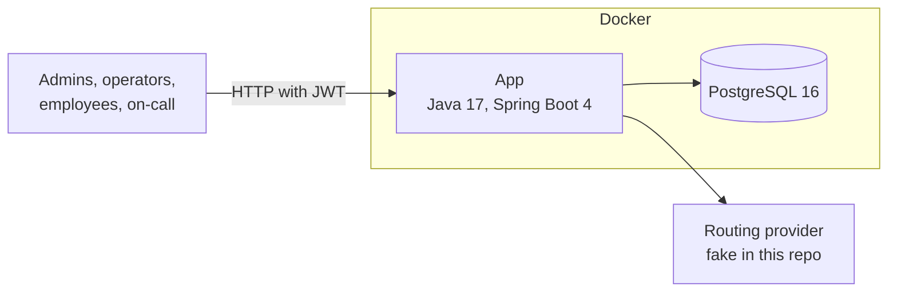

The fake provider runs inside the app. A real one would be an external call behind the same interface.

### Layers

Requests move downward, and each layer only talks to the one below it.

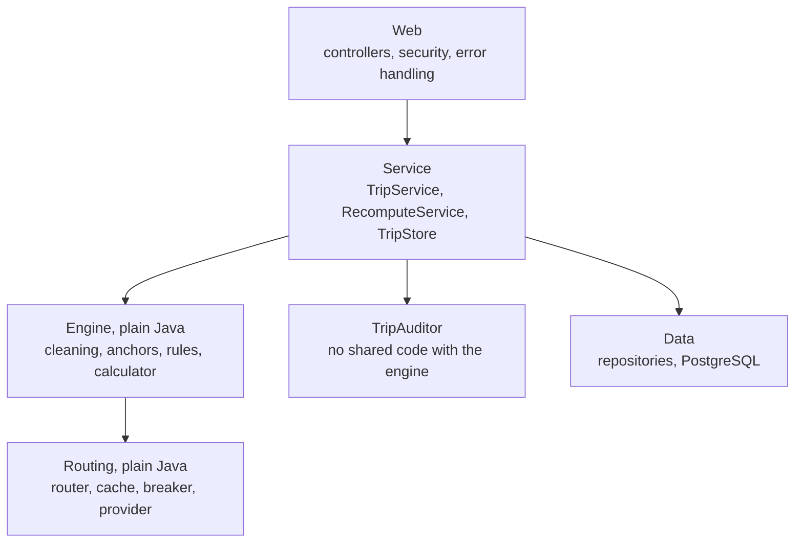

### Package rules

| Package | May use Spring? | Holds |
|---|---|---|
| `model` | No | Immutable trip data |
| `core` | No | Cleaning, anchors, rules, calculator, evidence hash |
| `routing` | No | Provider interface, cache, breaker, router |
| `audit` | No | The independent checker |
| `simulation`, `benchmark` | No | Fake trips and measurements |
| `controller`, `dto`, `security`, `error` | Yes | The web edge |
| `service`, `repository`, `entity`, `monitoring` | Yes | Application logic and storage |

The boundary is checked by searching the imports, and these packages import no Spring, JPA or Jackson code.

---

## 3. How the main flows work

### The trip pipeline

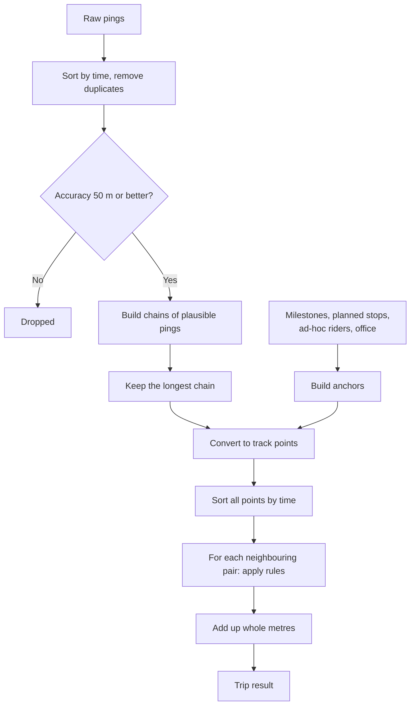

### Deciding the rule for one pair of points

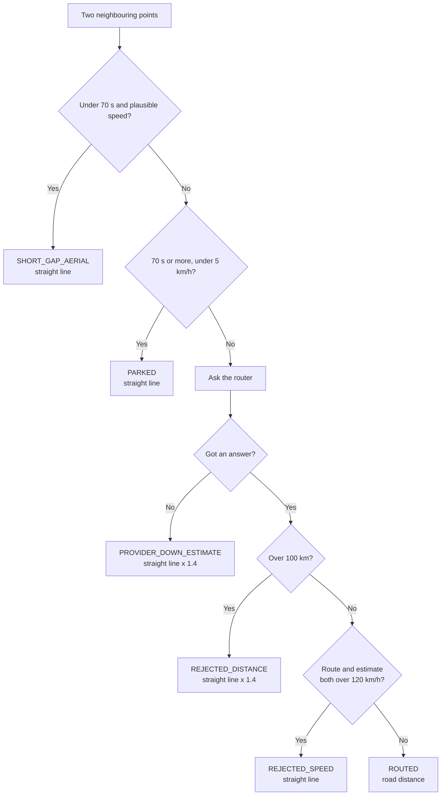

### Submitting a trip

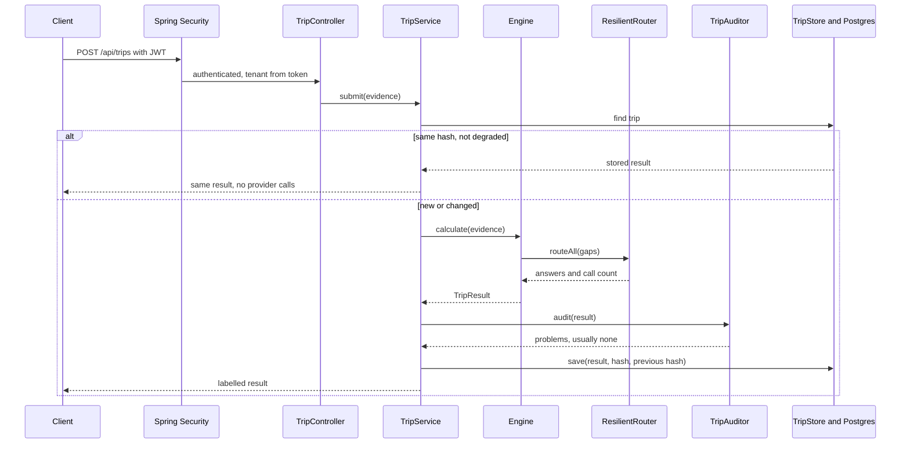

### A routing call

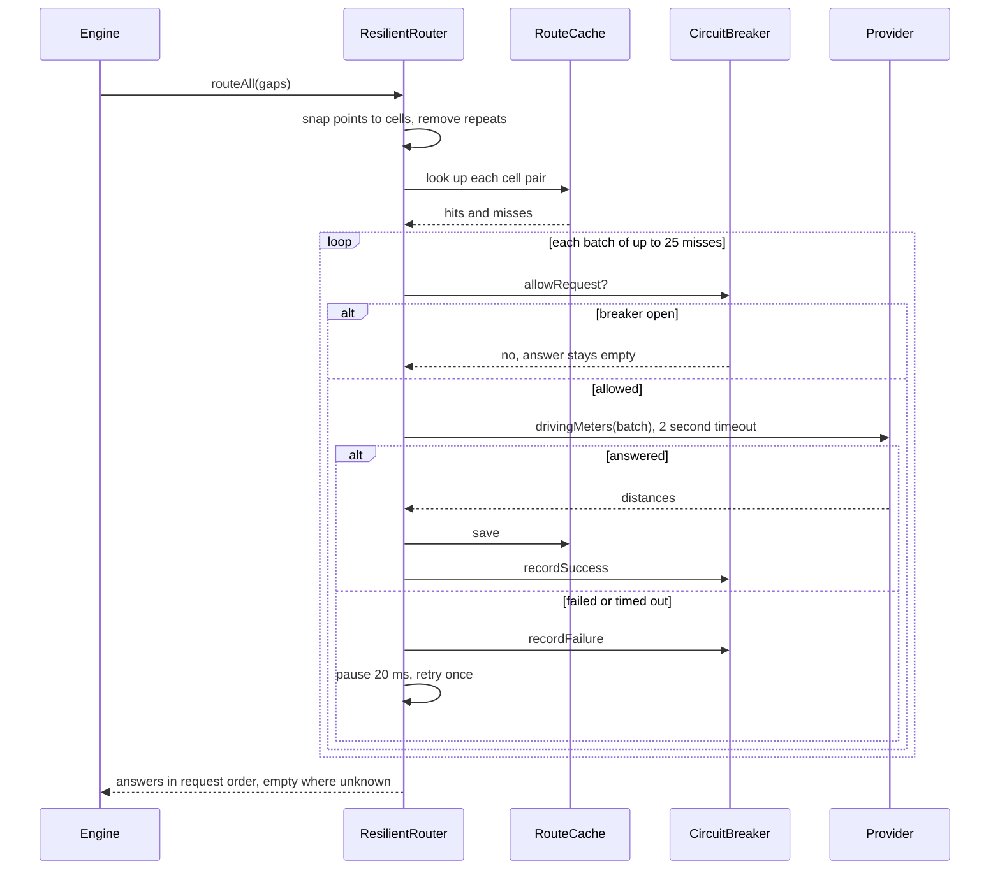

### Provider outage and recovery

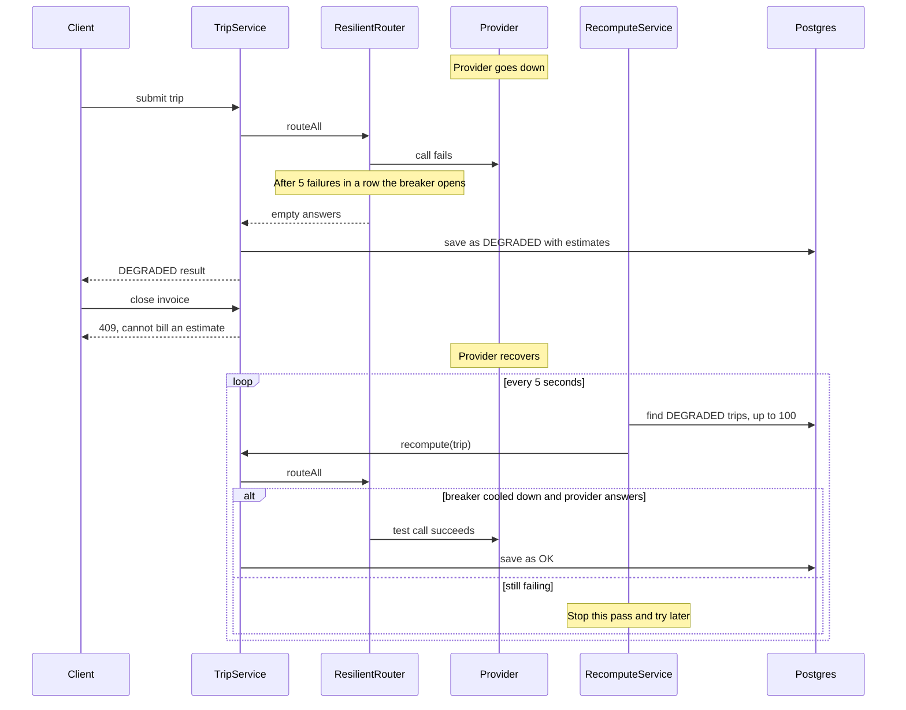

### Late pings after billing

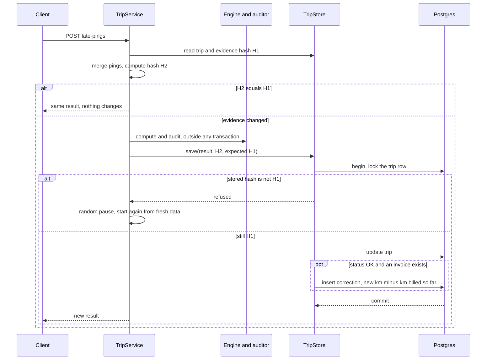

### Closing an invoice

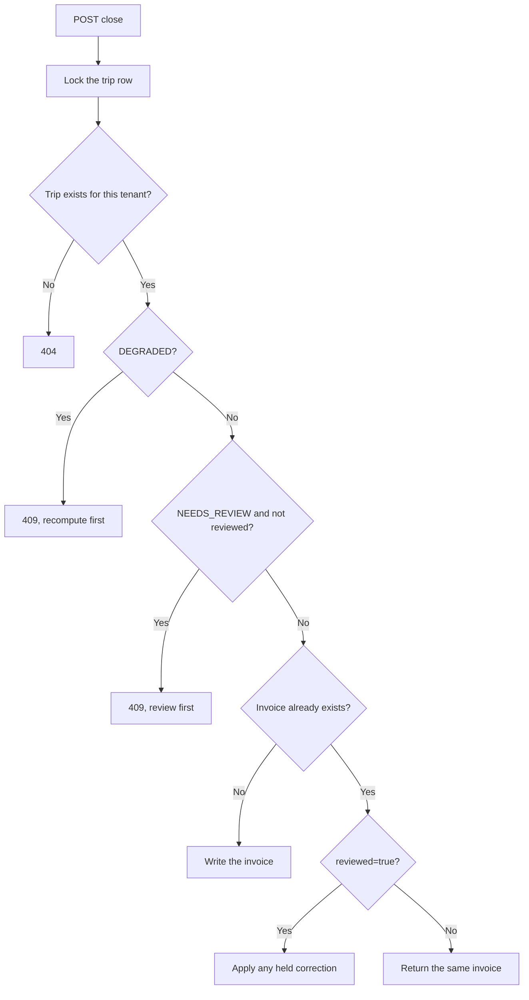

---

## 4. State machines

### Trip status

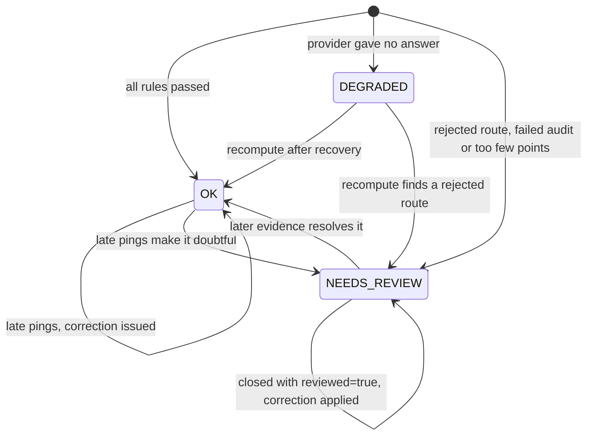

### Circuit breaker

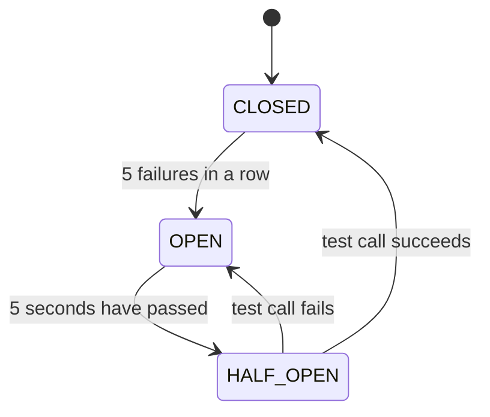

While `HALF_OPEN`, only one test call is allowed through.

---

## 5. Data model

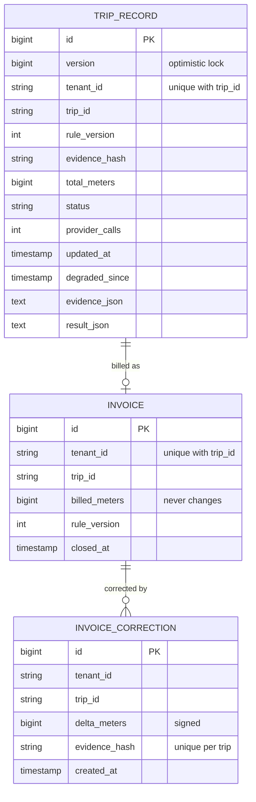

### In-memory model

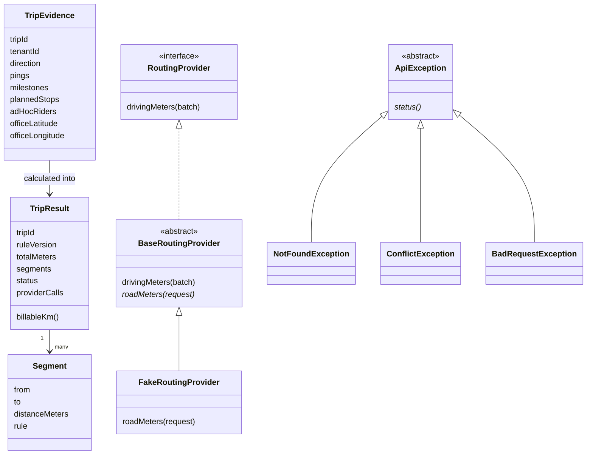

---

## 6. Concurrency model

| Shared thing | Who touches it | Protection |
|---|---|---|
| `RouteCache` | Every thread computing a trip | `synchronized` methods |
| `CircuitBreaker` | Every thread calling the provider | `synchronized` methods |
| Provider calls | Router threads | A semaphore caps calls at 16, and each runs on a pool thread so it can time out |
| A trip's row | Late pings, recompute, close | Row lock during save and close, hash check, `@Version` |
| A trip's row, first insert | Two submits of one new trip | Unique constraint, then retry |
| Counters | Everything | `AtomicLong`, Micrometer counters |

Each protection covers a different gap:

| Layer | Stops |
|---|---|
| Evidence hash check | Saving a result computed from old evidence |
| Row lock | A close and a save overlapping |
| `@Version` | A second line of defence against an update slipping through |
| Unique constraints | Two rows for one trip, two invoices, two corrections for one evidence hash |

Trips are independent, so computing them in parallel needs no coordination beyond these.

---

## 7. Decision records

Each record gives the options, the decision, why, what it cost, and when it should change.

### D1. Java 17 and Spring Boot

| Option | For | Against |
|---|---|---|
| **Java + Spring Boot** | Preferred by the case study, threads share memory, security and metrics built in | More framework to learn |
| Python + FastAPI | Quick to write | Single-thread limit, process workers would need shared cache and breaker state |
| Go | Simple concurrency | Not preferred, less suited to the layered OOP asked for |

**Decided:** Java with Spring Boot.
**Why:** It's the preferred stack, and threads sharing one cache and breaker remove the need for Redis.
**Cost:** Spring Boot's startup time and memory.
**Change when:** There is no reason to at this scale.

### D2. PostgreSQL

| Option | For | Against |
|---|---|---|
| **PostgreSQL** | Transactions, row locks, unique constraints | A server to run |
| MongoDB | Natural fit for evidence documents | Weaker fit for invoice rules that need several rows to change together |
| In-memory only | Simple | Bills vanish on restart |

**Decided:** PostgreSQL.
**Why:** A result and its correction must commit together, and an invoice must exist exactly once. Those are relational guarantees.
**Cost:** Evidence is stored as text, which Postgres can't query into.
**Change when:** Evidence storage grows too large, then move it to object storage and keep a pointer.

### D3. Whole metres in a `long`

| Option | For | Against |
|---|---|---|
| **Whole metres, `long`** | Sums never drift, and no overflow in practice | A segment loses sub-metre detail |
| `double` km | Natural to write | Adding in a different order can give a different total |
| `BigDecimal` | Exact decimals | Slow, and unnecessary below a metre |

**Decided:** Round each segment to a whole metre, sum exactly, round once to 0.1 km at billing.
**Why:** The case study says two runs that disagree by 0.1 km are a billing bug.
**Cost:** Under half a metre of error per segment, which averages out.
**Change when:** A contract needs finer precision.

### D4. `StrictMath`

| Option | For | Against |
|---|---|---|
| **`StrictMath`** | Same result on every machine | Slightly slower |
| `Math` | Faster | May differ in the last digit between JVMs |

**Decided:** `StrictMath`.
**Why:** A bill must repeat across machines. Speed here doesn't matter, because the provider dominates.
**Cost:** A small CPU cost.
**Change when:** Never for billing.

### D5. Haversine for straight lines

| Option | For | Against |
|---|---|---|
| **Haversine** | Named in the case study, simple | Treats Earth as a sphere |
| Vincenty | More accurate on an ellipsoid | Far more code for centimetres over short hops |
| Flat-map distance | Fastest | Wrong as distances grow |

**Decided:** Haversine.
**Why:** The case study asks for it, and most hops are tens of metres.
**Cost:** About 0.5% error at worst from the sphere assumption.
**Change when:** Never, since the rule itself names it.

### D6. Teleport filter by longest chain

| Option | For | Against |
|---|---|---|
| **Longest chain of plausible pings** | A bad first ping or a burst can't delete the trip | O(n²) on pure noise |
| Compare with the last good ping | Simple, O(n) | One bad first ping makes every good ping look like a teleport |
| Compare with the trip-start point | Simple | A wrong start point deletes everything |

**Decided:** Group pings into chains and keep the longest.
**Why:** The simple filter fails silently, and the failure is expensive. It would pay nearly zero for a real trip.
**Cost:** Worst-case time on data that is all noise. [RESULTS.md](RESULTS.md) measures it.
**Change when:** Device data proves noisy enough for the worst case to matter, then cap the chain count.

### D7. Rules in a fixed code order

| Option | For | Against |
|---|---|---|
| **Fixed order in one class** | Easy to read, audit and defend | A rule change needs a deploy |
| Rules engine or database rules | Change without a deploy | Hides logic, harder to prove deterministic |
| One class per rule (strategy) | Textbook OOP | Six small classes hide a simple order |

**Decided:** One class, one fixed order.
**Why:** The case study says rule order must be deterministic. A straight reading of `SegmentRuleEngine` is the proof.
**Cost:** A deploy for any rule change.
**Change when:** Clients need different rule sets.

### D8. Rule version and configurable limits

| Option | For | Against |
|---|---|---|
| **Limits in configuration, version on every result** | Limits change without code | The version must be raised by hand |
| Limits in code | Can't drift | The case study asks for configurable limits |
| Store all limits with each result | Fully traceable | Heavier rows |

**Decided:** `app.rules` in configuration, and every result stores `ruleVersion`.
**Why:** It meets both "configurable" and "versioned".
**Cost:** Forgetting to raise the version would break the guarantee. Old rule versions aren't kept runnable.
**Change when:** Rules start changing often, then keep each version's rules as data.

### D9. Batching by trip, in two passes

| Option | For | Against |
|---|---|---|
| **Collect a trip's gaps, then ask together** | One call per trip in most cases | Holds a trip's gaps until all are known |
| One call per gap | Simple | The most expensive option |
| Global batching across trips | Fewest calls | A queue, timers and more failure modes |

**Decided:** Two passes through the points: collect gaps, ask, then build segments.
**Why:** It halves calls with almost no complexity.
**Cost:** Doesn't combine gaps across trips.
**Change when:** Provider cost dominates after caching.

### D10. Snap to cells of 0.0005 degrees

| Option | For | Against |
|---|---|---|
| **Ask about cell centres** | A cached answer equals a fresh one | Endpoints move slightly |
| Cache by cell, ask about exact points | Slightly more accurate | The km would depend on which trip filled the cache, which breaks determinism |
| No snapping | Exact | Almost no cache hits |

**Decided:** Cells of about 55 m, with the provider always asked about the centre.
**Why:** This is the subtle one. Caching by cell while asking about exact points would make the bill depend on cache contents, and the same trip could then bill differently on two runs.
**Cost:** Each endpoint can move by up to about 40 m.
**Change when:** Measured accuracy on real data says cells should be smaller.

### D11. In-process LRU cache

| Option | For | Against |
|---|---|---|
| **`LinkedHashMap` LRU with a TTL** | No dependency, easy to read | One JVM, coarse locking |
| Caffeine | Faster under contention | One more library, for no measured need |
| Redis | Shared across instances | One more server for a single instance |

**Decided:** A small hand-written cache of 200,000 entries with a 24-hour TTL.
**Why:** One instance is enough here, and threads share it for free.
**Cost:** Lost on restart, and locked as a whole.
**Change when:** Running several instances, then use Redis.

### D12. Hand-written circuit breaker

| Option | For | Against |
|---|---|---|
| **Small custom class** | Short, fully testable, injectable clock | Less featured |
| Resilience4j | Battle-tested, more options | A dependency to explain, more than is needed |

**Decided:** About 60 lines with three states.
**Why:** The behaviour needed is small, and being able to read all of it helps when defending it.
**Cost:** No rolling failure rate, only consecutive failures.
**Change when:** Providers fail intermittently rather than outright.

### D13. Two-second timeout and one retry

| Option | For | Against |
|---|---|---|
| **2 s, one retry, 20 ms pause** | Bounded wait | A slow but working provider gets treated as failed |
| No timeout | Never gives up too early | A hung provider hangs the trip forever |
| Many retries with long backoff | Rides out blips | Holds threads and adds cost |

**Decided:** 2 seconds per call, one retry.
**Why:** The fallback is safe, because `DEGRADED` trips are recomputed, so giving up early costs little.
**Cost:** The retry pause is fixed, with no jitter.
**Change when:** Real provider latency is known.

### D14. A fake provider on a street grid

| Option | For | Against |
|---|---|---|
| **Fake on a grid** | Free, repeatable, true distance is known | Not a real road network |
| Real maps API | Real data | Costs money, needs a key, failures can't be scripted |
| OSRM in Docker | Real roads, free | Large map data and disk, slow to set up |

**Decided:** A fake where road distance is north-south plus east-west.
**Why:** Accuracy can only be measured if the truth is known, and failures must be repeatable.
**Cost:** All accuracy figures are simulated.
**Change when:** Before production, plugging in through `BaseRoutingProvider`.

### D15. Idempotency by evidence hash

| Option | For | Against |
|---|---|---|
| **SHA-256 of sorted, deduplicated evidence** | Works for any replay, order-independent | Hashing cost on each submit |
| Client-sent idempotency key | Standard for APIs | A device feed may not send one, and it misses the same data arriving in a new order |
| Compare stored JSON | No hash | Sensitive to order |

**Decided:** Hash the evidence with the rule version.
**Why:** The case study's guarantee is about the same input, not the same request.
**Cost:** A small CPU cost.
**Change when:** No reason to.

### D16. Compute outside the transaction, then compare-and-set

| Option | For | Against |
|---|---|---|
| **Compute, then save only if the evidence is unchanged** | No connection held during slow calls | Retry logic |
| Hold a lock while computing | Simple reasoning | A slow provider would hold database connections and block the pool |
| Last write wins | Simplest | Loses pings silently |

**Decided:** Compute first, then lock the row and save only if the stored hash matches.
**Why:** A provider call can take seconds, which is too long to hold a row lock or connection. The concurrency test caught last-write-wins losing pings in a real run.
**Cost:** Retries under heavy contention, up to 10 attempts, then a 409.
**Change when:** One trip regularly gets many updates at once, then queue updates per trip.

### D17. Evidence stored as JSON in the trip row

| Option | For | Against |
|---|---|---|
| **JSON text column** | One row per trip, simple recompute | About 105 KB per trip, not queryable |
| A `pings` table | Queryable | 15M rows per 10,000 trips |
| Object storage | Cheap at scale | One more system |

**Decided:** JSON in the row.
**Why:** Evidence is only ever read whole, for recompute.
**Cost:** Storage, and slower writes. [RESULTS.md](RESULTS.md) shows the effect on the API.
**Change when:** Volume grows, then move to object storage.

### D18. Invoices never change, corrections add up

| Option | For | Against |
|---|---|---|
| **Immutable invoice plus signed corrections** | Full history, nothing silent | Current value must be computed |
| Update the invoice | Simple | Exactly what the case study forbids |
| Void and reissue | Common in accounting | Heavier than a signed delta |

**Decided:** A ledger of signed corrections.
**Why:** The case study asks for a signed delta rather than a changed invoice.
**Cost:** Reading the current km means adding up corrections.
**Change when:** No reason to.

### D19. Recompute by scheduled polling

| Option | For | Against |
|---|---|---|
| **Poll for DEGRADED trips every 5 seconds** | Survives a crash, because Postgres is the queue | A little idle querying |
| Message queue | Instant, scalable | One more system |
| In-memory retry list | Simple | Lost on a crash |

**Decided:** Poll, up to 100 trips at a time.
**Why:** Status in Postgres survives `kill -9`, which was tested.
**Cost:** Up to about 5 seconds of extra delay. Stops at the first trip that is still degraded.
**Change when:** Outages leave very large backlogs.

### D20. A separate auditor

| Option | For | Against |
|---|---|---|
| **Separate class with its own formula** | Catches engine bugs before billing | Rules exist twice |
| Rely on tests only | Less code | Tests check known cases, not every live result |
| A second language | Stronger independence | More to build and defend |

**Decided:** `TripAuditor` shares no code with `core`.
**Why:** Money justifies a second opinion on every result.
**Cost:** Both must change when the rules change, and a misreading of the written rules passes both.
**Change when:** No reason to. Add simulator truth checks where needed.

### D21. JWT through Spring's resource server

| Option | For | Against |
|---|---|---|
| **Signed JWT, HS256, Spring's support** | Stateless, standard, no custom crypto | No revocation before expiry |
| Hand-written token filter | Fewer dependencies | Security code you should not write yourself |
| Server sessions | Easy revocation | State to share and store |
| OAuth with an identity provider | The real answer for production | Needs an external service |

**Decided:** Spring's resource server, with one-hour tokens.
**Why:** Secure defaults with little code.
**Cost:** Tokens can't be withdrawn early, and users are demo accounts.
**Change when:** Connecting a client's real identity provider.

### D22. Tenant from the token, 404 for others

| Option | For | Against |
|---|---|---|
| **Tenant from the signed token, in every lookup, 404 if absent** | Can't be forged, reveals nothing | Every query must include it |
| Tenant in the request | Simple | Anyone can claim any tenant |
| 403 for another tenant's trip | Clearer | Confirms that the trip exists |

**Decided:** Token tenant, and a plain 404.
**Why:** The case study says one client can never read another's data, and even knowing that a trip exists is a small leak.
**Cost:** None worth noting.
**Change when:** Never.

### D23. Employees see no coordinates

| Option | For | Against |
|---|---|---|
| **Labels and km, no coordinates** | Other riders' homes stay private | Employees can't see their own route |
| Full detail | Simple | Exposes other riders' homes on a shared trip |

**Decided:** Coordinates are removed for employees.
**Why:** A shared cab's segments end at colleagues' homes.
**Cost:** Less detail for employees.
**Change when:** A rider's own points can be separated from the others'.

### D24. Safe errors

| Option | For | Against |
|---|---|---|
| **Named fields, never values, `ProblemDetail`** | Useful and safe | Slightly less detail |
| Echo the invalid value | Easier debugging | Can repeat a phone number or location |
| Generic "bad request" | Safest | Not meaningful |

**Decided:** Say which field is wrong, never what it contained.
**Why:** The case study wants both meaningful and non-leaking.
**Cost:** Debugging relies on the caller's own data.
**Change when:** Never.

### D25. Office anchor on logout trips

| Option | For | Against |
|---|---|---|
| **Apply the rule at the office end of the trip** | Keeps the spec's 30.6 km logout example true | Not the literal wording |
| Apply the wording literally | Word for word | Adds a false return leg of about 30 km to every logout trip |
| No office anchor on logout | Simple | Loses the known start point |

**Decided:** LOGIN uses the trip end, and LOGOUT uses the trip start.
**Why:** The case study's rule and its own logout example can't both hold.
**Cost:** The office anchor at trip start is a reading, not stated text.
**Change when:** MoveInSync confirms the intended rule.

### D26. Fallbacks for rejected routes

| Option | For | Against |
|---|---|---|
| **Over 100 km: × 1.4. Too fast: plain straight line. Both flag review** | Pays a defensible figure, and a person checks | The case study doesn't define it |
| Zero | Never overpays | Unfair to a vendor who drove the distance |
| Use the rejected route | Simple | Pays for a route already judged wrong |

**Decided:** As in the first row.
**Why:** A too-fast estimate is impossible, so only the lowest defensible figure stands until review.
**Cost:** A person must look at flagged trips.
**Change when:** MoveInSync defines its rule.

### D27. Corrections wait for a clean result

| Option | For | Against |
|---|---|---|
| **Correct only on `OK`, hold for `DEGRADED` and `NEEDS_REVIEW`** | No doubtful number reaches a bill | A held correction needs action |
| Correct on anything not degraded | Fewer steps | A flagged number changes a bill unchecked |

**Decided:** Only a clean result changes a bill. Closing with `reviewed=true` applies a held correction.
**Why:** It keeps the "trusted bill" promise.
**Cost:** Who reviewed isn't recorded.
**Change when:** A review workflow is needed.

### D28. Simulator with known truth

| Option | For | Against |
|---|---|---|
| **Fixed corridors, known distance, injected bad data** | Accuracy is measurable, runs repeat from a seed | Synthetic |
| Random points | Trivial | Nothing to measure against, no realistic cache behaviour |
| Replay real GPS | Realistic | No such data, and no ground truth |

**Decided:** 300 fixed corridors, with tunnels, stops, false fixes and missing milestones.
**Why:** Repeating corridors mirror shift routes and let caching behave naturally.
**Cost:** The results describe the simulator, not real roads.
**Change when:** Real trips with odometer readings exist.

### D29. Micrometer metrics and structured logs

| Option | For | Against |
|---|---|---|
| **Micrometer, Prometheus format, JSON logs** | Comes with Spring, standard tools read it | The degraded gauges run a query per scrape |
| Custom status endpoint | Simple | Non-standard |
| Logs only | No metrics work | Can't alert on a trend |

**Decided:** Micrometer and ECS-format JSON logs.
**Why:** It gives the case study's five named signals with little code.
**Cost:** A small query on each scrape.
**Change when:** Scrape cost matters.

### D30. Hibernate schema updates

| Option | For | Against |
|---|---|---|
| **`ddl-auto: update`** | One command works from empty | Unsafe for real production changes |
| Flyway migrations | Versioned, reviewable | More setup for a case study |

**Decided:** `ddl-auto: update`.
**Why:** The aim is a simple one-command run.
**Cost:** No migration history.
**Change when:** Before production, move to Flyway.

---

## 8. What changes at 100 times the load

| Pressure | First sign | Response |
|---|---|---|
| Provider limits | `provider_failures` rises and the breaker opens | Larger batches across trips, a paid tier, a longer cache TTL |
| One JVM | CPU saturated | Several instances with Redis for the cache and breaker |
| Evidence size | Postgres disk and write time | Move evidence to object storage |
| Recompute backlog | `trips_degraded_oldest_age_seconds` grows | A queue with parallel workers |
| One Postgres | Row locks and connection limits | Partition by tenant, read replicas |

Current measurements are in [RESULTS.md](RESULTS.md), and known gaps are in [LIMITATIONS.md](LIMITATIONS.md).
