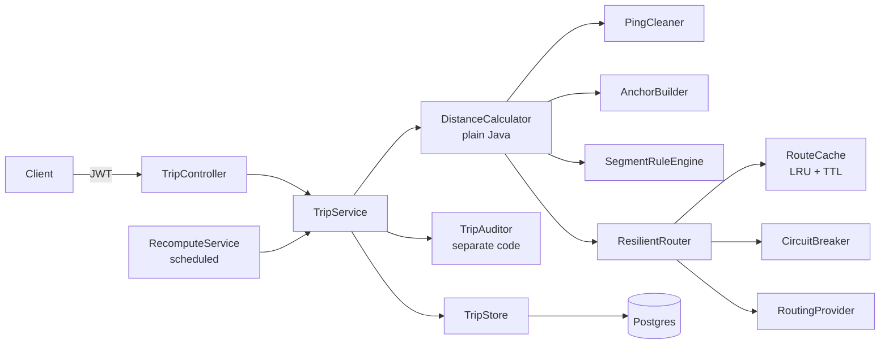
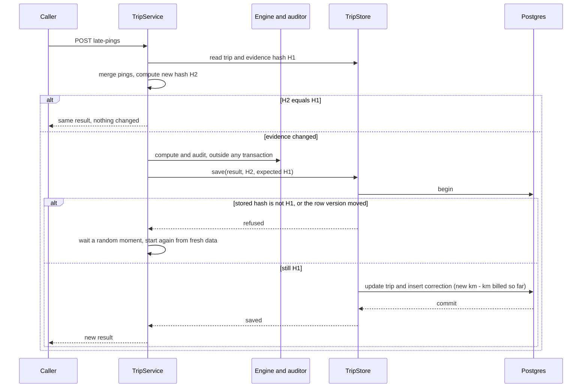

# Design note

## The problem

Vendors are paid per km, and GPS loses data. The engine rebuilds each trip's distance from pings and known stops, using routing calls only for real gaps, and explains every km.

## Architecture

The engine has no Spring dependency, so it runs in tests and in the benchmark with no server or database.

## Hardest flow: late pings after billing

The provider call must not sit inside a database transaction, so computing happens outside one. That creates a read-compute-write race, which the concurrency test exposed: two updates could read the same trip and the second save dropped the first one's pings. The expected-hash check closes it, and `@Version` covers the instant between that check and the commit.

## Consistency model

A trip is always answered, even with the provider down. That choice favours availability. Billing favours consistency: an estimate can never reach an invoice, and an invoice is never changed. The two meet at `DEGRADED`, which is visible, blocks billing, and resolves automatically.

Latency is traded against accuracy in one place. A slow provider is given 2 seconds per call, then one retry, so a request stays bounded instead of waiting forever. After that the caller gets an estimate straight away, and accuracy returns later through the recompute. Cached routes are the fast path, at the cost of answers up to 24 hours old.

## Failure modes

| What fails | What the user sees | How the system recovers |
|---|---|---|
| Provider down or timing out | Trip returns `DEGRADED` with estimated segments, and closing it gives 409 | Each call times out after 2 seconds. One retry, then the breaker opens. `RecomputeService` recomputes within seconds of recovery |
| One batch fails, others succeed | Trip keeps its real routes, the failed gaps are estimated, and it is `DEGRADED` | Recomputed like any degraded trip |
| Provider rate limit | Same as above | Concurrent calls are capped by a semaphore, and the breaker backs off |
| App killed mid-work | Requests fail until restart | Evidence and status are in Postgres, so degraded trips are picked up after restart. Tested with `kill -9` |
| Crash between result and correction | Nothing partial | Both commit in one transaction |
| Duplicate or replayed feed | Same result returned | Evidence hash match, with no provider calls |
| Out-of-order or duplicate pings | Same km | Sorted and deduplicated before any rule runs |
| Bad fix burst, including at trip start | Those pings are dropped | Longest plausible chain |
| Concurrent updates to one trip | Both succeed | Compare-and-set with retry, or 409 after 10 attempts |
| Auditor disagrees | `NEEDS_REVIEW` | Blocked from billing until reviewed |
| Postgres down | A generic error, expected to be a 500. Not tested | The caller retries, and replays are safe |

## Trade-offs

- **Snapped cells cost accuracy for determinism.** The provider is asked about cell centres (0.0005°, about 55 m), so a cached answer equals a fresh one. Each endpoint can move by up to about 40 m.
- **Evidence is stored as JSON in the trip row.** It is simple and makes recompute easy, at about 160 KB per trip.
- **The cache and breaker live in one JVM.** Threads share them cheaply, and losing them on restart costs only some extra provider calls.
- **The auditor is separate code, not a separate team.** It has its own formula and shares no engine code, but a misreading of the written rules would pass both. The simulator's true distances are a second check.

## Known limits

- An invoice closed at the same moment as a late-ping update can miss that correction, and two closes at the same moment can return a 500.
- A late-ping update that puts a closed trip into `NEEDS_REVIEW` still issues its correction.

## Left out on purpose

A real routing provider, running several app instances, schema migrations, login rate limiting, encryption of stored evidence, and road-accurate map matching. With a real provider, answers can change over time, so a recompute after late pings could also shift by that drift. Storing each trip's route answers would fix this.
